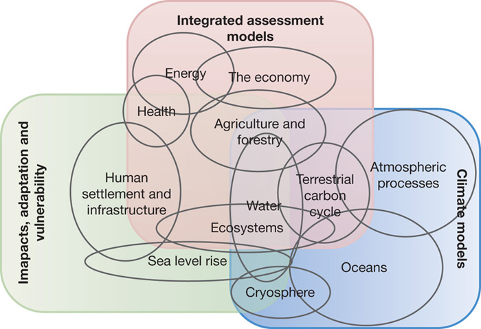

# Introduction

{#fig-Nature fig-align="center"}

A secondary part of this unit will involve more in-depth analysis of the physical models that govern the *Climate Models* in @fig-Nature.  This shifts the emphasis from conceptual models to a greater focus on the underlying physics, this also falls into the category of Mathematical Geoscience or Fluid Mechanics. 